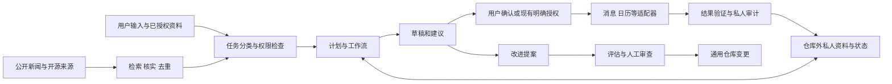

# 系统设计

## 组件与数据流



这是组件设计，图中的连接尚未实现。先以文档和手工流程验证价值，再选择单一运行底座；不要为同时采用多个 agent 框架增加复杂度。

初期由 dot 协助开发和管理，也可承担主控制入口；它不是核心逻辑的必要依赖。控制入口、执行 agent、调度后端和输出渠道是不同组件，分别绑定适配器。用户规则与权限属于核心，平台会话、工具调用格式和专有检查点属于适配层。可替换契约见[agent 可替换设计](agent-portability.md)。

## 本地数据约定

公共仓库存放规则、模板、无身份配置。Mac 上另外选择一个仓库外的私有根目录，内部建议：

```text
<private-root>/
  inbox/        # 待整理输入
  projects/     # 项目
  areas/        # 长期责任
  resources/    # 参考笔记和来源链接
  archive/      # 已结束事项
  journal/      # 日常记录
  profile/      # 明确偏好、反馈、推荐策略版本
  state/        # 工作流、去重键、运行水位
  audit/        # 执行及策略调整记录
```

Markdown/JSON 为主要可读记录；搜索索引、向量库和摘要是可重建的派生数据，不是唯一信息来源。dot 或任何 agent 的聊天历史与专有记忆都不能成为唯一状态存储。若未来依赖数据库，必须有可恢复导出和附件备份。本地优先描述存储选择；调用云模型或搜索服务依然可能向服务商发送内容，需单独配置范围。

## 消息与日历适配器

- 飞书工作与个人账号使用独立凭据、目标映射和审计记录。每次写操作携带明确账号上下文、目标和幂等键，禁止失败后切换另一个账号重试。
- Apple iCloud 日历使用私人配置选择日历，禁止将真实日历名、ID、事件或截屏写入公共示例。界面操作可作为原型；稳定接口及 macOS 权限需要单独验证。
- “界面测试成功”不代表后台凭据、持续服务或跨设备送达已经可用。集成未实现时明确返回 `not_configured`。

## 执行状态与恢复

工作项状态：`draft → ready → running → succeeded / failed / uncertain / skipped`。发送和事件创建通过稳定任务 ID 与目标产生幂等键。超时后先查询实际结果；结果未知时不得盲目重发。内容收集使用事件簇、原始 URL、内容指纹和版本去重。

电脑休眠或离线时记录错过窗口。新闻恢复后只提供仍有价值的摘要；过时提醒标记过期，不补发一串通知。失败采用有上限的退避，记录原因，并允许人工重跑。私有审计记录只存必要字段，设保留期。

## 性能与成本

先定义小规模本地基准：每次来源数、抓取总量、摘要输入上限、模型调用数、总时间与费用。并行只用于独立检索，写操作顺序执行。缓存按来源更新频率过期；原文变化时重核实。重大信息无法核实就降低置信度或暂缓，不靠增加模型调用伪造确定性。预算达到上限时交付部分结果并列出未覆盖范围。
